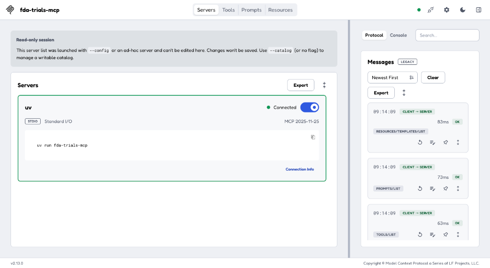
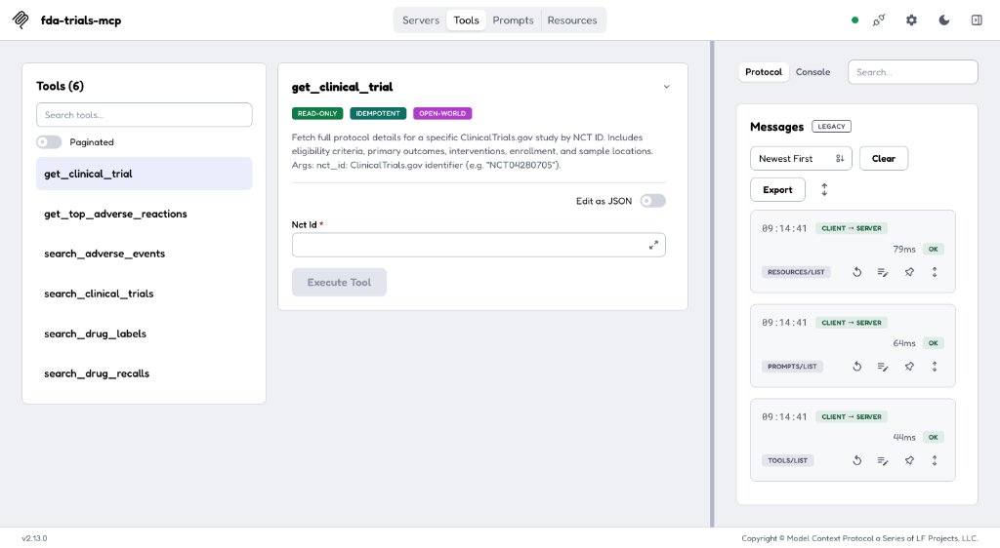
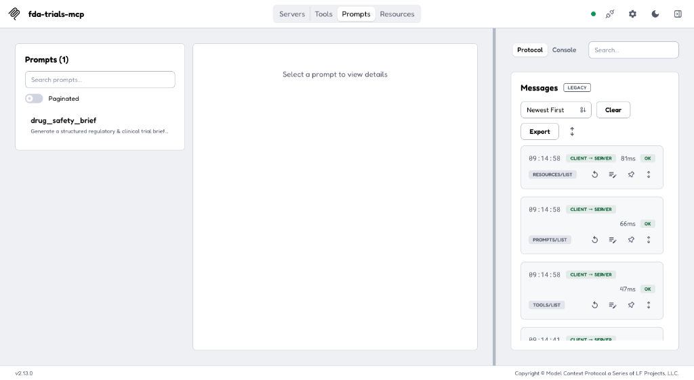
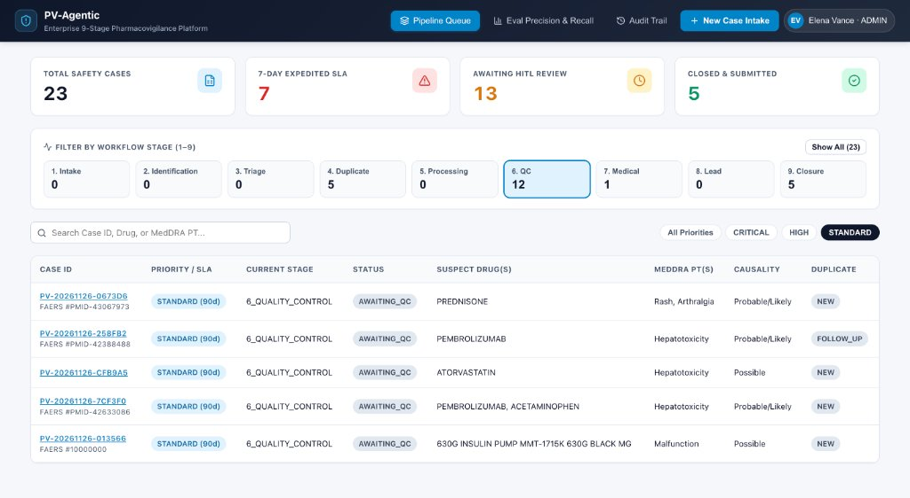

# fda-trials-mcp

A lightweight, shippable [Model Context Protocol (MCP)](https://modelcontextprotocol.io/) server that exposes **openFDA** (drug labels, FAERS adverse events, drug recalls) and **ClinicalTrials.gov v2** data to any MCP-compatible LLM client.

Raw regulatory and clinical trial JSON responses are large and deeply nested. `fda-trials-mcp` queries these public APIs, filters and truncates verbose boilerplate, and returns clean, token-efficient structured summaries.

## Tools

| Tool | Source | Description |
| --- | --- | --- |
| `search_drug_labels` | openFDA (`drug/label`) | Search FDA product labels by brand, generic, or substance name (indications, boxed warnings, contraindications, dosage, interactions). |
| `search_adverse_events` | openFDA (`drug/event`) | Search FAERS adverse event case reports with optional reaction and `serious_only` filters. |
| `get_top_adverse_reactions` | openFDA (`drug/event`) | Aggregate the most frequently reported MedDRA adverse reactions for a drug. |
| `search_drug_recalls` | openFDA (`drug/enforcement`) | Search FDA drug recall and enforcement reports by drug name, recalling firm, or class (`Class I`/`II`/`III`). |
| `search_clinical_trials` | ClinicalTrials.gov (`v2/studies`) | Search trials by condition, intervention/drug, recruitment status, phase, or sponsor. |
| `get_clinical_trial` | ClinicalTrials.gov (`v2/studies/{nctId}`) | Fetch full protocol details for an NCT ID (eligibility criteria, primary outcomes, enrollment, sample locations). |

It also includes an MCP prompt, `drug_safety_brief`, to synthesize a structured regulatory, safety, and trial brief for a given drug.

## Screenshots

### MCP Inspector — Server Connection


### MCP Inspector — Registered Tools (6)


### MCP Inspector — Prompt (`drug_safety_brief`)


### Pharmacovigilance Integration (`PV-Agentic`)


## Quick Start

Requires Python 3.10+ and [`uv`](https://docs.astral.sh/uv/).

```bash
uv sync
uv run fda-trials-mcp
```

### Optional: `FDA_API_KEY`

openFDA works without an API key (up to 240 requests/minute, 1,000 requests/day per IP). To raise the daily limit to 120,000 requests/day, register for a free key at [open.fda.gov/apis/authentication](https://open.fda.gov/apis/authentication/) and set `FDA_API_KEY` in your environment.

## Client Configuration

Add the following to your MCP client configuration (e.g., Claude Desktop `claude_desktop_config.json`, Cursor `.cursor/mcp.json`, or VS Code / Antigravity MCP config):

```json
{
  "mcpServers": {
    "fda-trials": {
      "command": "uv",
      "args": [
        "--directory",
        "/ABSOLUTE/PATH/TO/fda-trials-mcp",
        "run",
        "fda-trials-mcp"
      ],
      "env": {
        "FDA_API_KEY": "optional-your-key-here"
      }
    }
  }
}
```

## Development

```bash
uv sync --extra dev
uv run pytest -v
```

## Data Sources & Terms

- **openFDA**: Data provided by the U.S. FDA via [open.fda.gov](https://open.fda.gov/apis/). FAERS reports are spontaneous submissions and do not establish causality.
- **ClinicalTrials.gov**: Study records provided by the U.S. National Library of Medicine via [clinicaltrials.gov](https://clinicaltrials.gov/).
