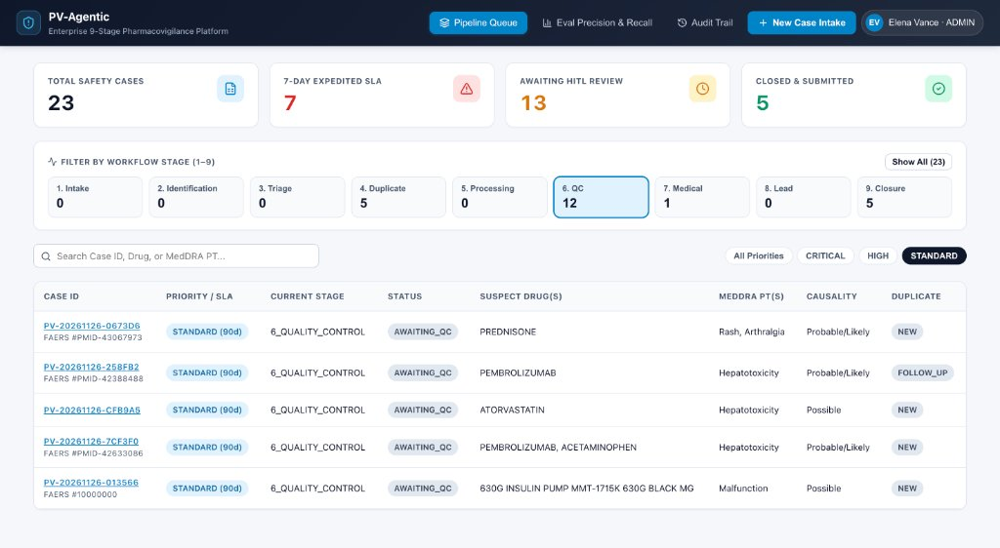

# PV-Agentic: Pharmacovigilance Case-Processing Multi-Agent Platform



An enterprise-grade, 9-stage pharmacovigilance case-processing multi-agent pipeline that ingests public, de-identified adverse event reports, extracts structured clinical fields, suggests MedDRA Preferred Terms (PT / LLT / SOC), assesses seriousness, causality (WHO-UMC & Naranjo), and expectedness/listedness, drafts ICH clinical narratives, and enforces **Human-in-the-Loop (HITL)** approvals with an **immutable SQLite audit trail**, **Enterprise RBAC**, **ICH E2B(R3) XML export**, and an **Evaluation Suite with per-field Precision & Recall**.

> **Data Privacy Notice**: Uses only public, de-identified regulatory/literature data (openFDA FAERS, openFDA MAUDE, PubMed, ClinicalTrials.gov) and synthetic clinical vignettes — never real patient data.

---

## 9-Stage Pharmacovigilance Workflow

1. **Case Intake**: Multi-source ingestion from openFDA FAERS (drugs), openFDA MAUDE (medical devices), PubMed literature case reports, ClinicalTrials.gov study safety results, and unstructured clinical narratives.
2. **Case Identification / Initial Assessment**: Automated ICH E2D 4-criteria validity check (Identifiable Patient, Identifiable Reporter, Suspect Product, Adverse Event).
3. **Triage**: Priority classification (`CRITICAL`, `HIGH`, `STANDARD`) and regulatory SLA assignment (`7-Day`, `15-Day`, `90-Day`).
4. **Duplicate Check**: Key + composite clinical similarity check classifying incoming reports as `NEW`, `FOLLOW_UP` (linked to parent case audit trail), or `DUPLICATE`.
5. **Case Processing / Data Entry**: Structured extraction, MedDRA PT/LLT/SOC coding suggestions with confidence scores, Seriousness (6 ICH E2A criteria), Causality (WHO-UMC + Naranjo), Listedness (CCDS/USPI), and ICH clinical narrative drafting.
6. **Quality Control (QC)**: Automated 6-point SOP checklist + Human QC Reviewer HITL gate (Approve or Return for Correction).
7. **Medical Review**: Automated MBBS/MD clinical coherence pre-check + Medical Reviewer MD HITL gate.
8. **Project Lead Review / Final Approval**: Final sign-off by Project Lead.
9. **Case Closure / Finalization**: Generates regulatory submission ID (`E2B-R3-*`), downloadable ICH E2B(R3) XML, and retains the immutable audit trail.

---

## Enterprise Role-Based Access Control (RBAC)

Enforces GxP separation of duties with HMAC-SHA256 signed Bearer tokens:
- `CASE_PROCESSOR`: Case intake, edit structured/MedDRA/narrative fields, re-run clinical & QC agents, submit Stage 5 → 6.
- `QC_REVIEWER`: Independent Stage 6 QC review (read-only on case fields).
- `MEDICAL_REVIEWER`: Stage 7 Medical Review (MD) sign-off, return for correction, or reject invalid.
- `PROJECT_LEAD`: Stage 8 Final Approval → Stage 9 Closure, and access to the Evaluation Suite.
- `ADMIN`: Full administrative access across all stages and tools.

---

## Evaluation Suite (Per-Field Precision & Recall)

Benchmarked across 14 cases (8 public openFDA FAERS records + 6 synthetic unstructured clinical narratives):
- **Macro Precision**: `0.9795` | **Macro Recall**: `0.9874` | **Macro F1**: `0.9833`
- Evaluates `case_validity`, `patient_sex`, `patient_age`, `reporter_qualification`, `suspect_drugs`, `concomitant_drugs`, `meddra_pts`, `seriousness_overall`, and `seriousness_criteria`.

---

## Running Locally

### 1. Start the Unified Server (API + Visual Dashboard)
```bash
uv run uvicorn backend.main:app --host 127.0.0.1 --port 8088
```
Open `http://127.0.0.1:8088` in your browser.

### 2. Optional: Frontend Dev Server (Hot Reload)
```bash
cd frontend
npm install && npm run dev
```

### 3. Run Evaluation Benchmark via CLI
```bash
uv run python -c "from backend.eval_suite import run_evaluation; import json; print(json.dumps(run_evaluation(), indent=2))"
```
